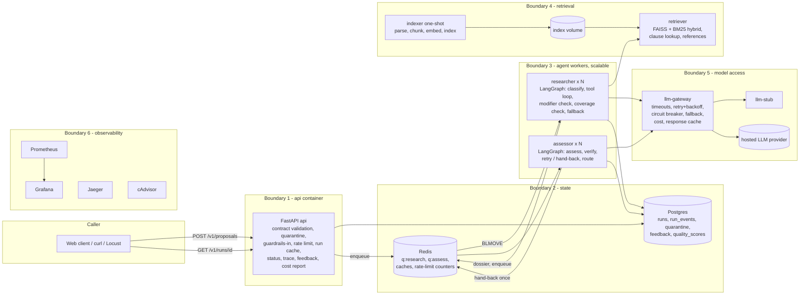

# Architecture

## Topology and deployment boundaries



| Boundary | Why it is separate |
|---|---|
| **api** | Different scaling and failure profile from the agents: cheap, I/O bound, must stay up and keep rejecting bad input even when every agent is busy or down. Owns the ingestion boundary so a malformed request never reaches a queue. |
| **researcher / assessor** | The only components whose load grows with model calls; they scale horizontally (`--scale`). Two containers, not two prompts: distinct responsibilities, separate queues, separate crash domains. An assessor crash never loses research (the dossier is persisted before hand-off). |
| **retriever + indexer** | Resource profile: holds the embedding model and index in memory (~1 GB image with CPU torch); the app image stays small (~250 MB). Independent release: re-indexing or swapping the embedding model never redeploys the agents. The indexer is a one-shot job so the serving process never pays for parsing. |
| **llm-gateway** | Failure isolation and cost control: the provider is the least reliable dependency, so its timeouts, retries, circuit breaker, fallback, caching and cost accounting live in one process with one view of provider health. Changing provider is a configuration change here only. |
| **llm-stub** | Lets the stack run with no key and lets load tests measure our system rather than a provider's rate limits (D6). |
| **redis / postgres** | State outlives any worker. Redis: queue + caches (fast, ephemeral, AOF on). Postgres: the audit record of every run (durable, queryable). |
| **observability** | Off the request path; a dead Grafana never affects a run. |

## Agent design

### Research agent (`src/bpc/agents/researcher.py`)

LangGraph state machine. Retrieval is a **tool the model chooses to call**:

| Tool | Purpose |
|---|---|
| `search_corpus(query, doc_id?, k?, mode?)` | hybrid / lexical / dense search |
| `get_clause(chunk_id)` | a clause by id plus its siblings (table <-> notes) |
| `follow_reference(reference)` | resolves "Table 9", "bye-law 16.0" to passages |
| `get_proposal_field(path)` | reads the validated proposal (notes come back fenced as untrusted data) |
| `record_provision(chunk_id, topic, why)` | adds a passage to the dossier; rejects ids never retrieved |
| `finish_research(summary)` | declares completion |

Control steps that make it an agent rather than a pipeline (design approach steps 2-5):

1. **classify** - category + entities + exemption / out-of-corpus signals (model + keyword screen).
2. **tool loop** - the model searches and records.
3. **modifier_check** (step 2 + 3) - when the model first calls `finish_research`, a separate
   call reads the recorded provisions and asks *which of these depend on a variable that another
   provision, stated elsewhere, might cap?* It returns queries derived from the text it read plus the
   cross-references found in those passages, and the loop resumes with them. A deterministic
   "variable interaction" expansion (height/FAR/setbacks x road width/height/plot size) is added.
4. **coverage_check** (step 5) - if a mandatory topic (setbacks, FAR, ground coverage, height) is
   still empty, the loop resumes with a different strategy (lexical mode, single document,
   references).
5. **fallback** - if the model is unavailable at any point: deterministic templated retrieval, the
   dossier is marked `degraded`.

**Loop bounds:** `RESEARCHER_MAX_STEPS` model turns (14), `RESEARCHER_MAX_TOOL_CALLS` (24),
`RESEARCHER_DEADLINE_S` wall clock (120 s, checked before every model call and passed as the
remaining budget to every timeout), LangGraph `recursion_limit` as a backstop, and 3 consecutive
retriever failures end the loop.

### Assessment agent (`src/bpc/agents/assessor.py`)

1. **assess** - one JSON answer: a finding per binding provision (status, required/proposed value,
   comparison, verbatim quote, derivation), conflicts, exemption signals, missing topics.
2. **verify** (step 4, `verify.py`) - deterministic: every citation must resolve to a passage
   retrieved *in this run*; the quote must be verbatim (whitespace/punctuation-normalised) text of
   that passage; every number must come from the passage or the proposal or follow from them via
   the stated derivation (evaluated with a safe arithmetic parser); `satisfied/violated` must agree
   with `proposed <comparison> required`; each mandatory topic needs a verified finding.
3. On failure (step 5): **retry** once with a different strategy (error list + strict re-quote
   instructions), then **hand back** to the research agent once with queries for the missing
   topics, then **escalate**: unverified findings are withheld, never returned.
4. **route** (`router.py`) - deterministic, never the model: degraded -> guardrail flags ->
   outside corpus -> unresolved conflict -> exemption -> any verified violation (revise) ->
   insufficient/unverified evidence (specialist) -> clear. Declared precedence (RMP-2015 ZR
   governs setbacks/FAR/coverage/height/use) resolves ZR-vs-bye-law disagreements; anything else
   escalates.
5. **output filter** - rewrites any sentence that would approve/certify/sanction.

### Hand-off and failure mid-run

```
api --q:research--> researcher --(dossier in Postgres)--q:assess--> assessor --> result
                         ^-------------- q:research (hand-back, max 1) --------'
```
* A job is leased (BLMOVE to a processing list + TTL lease, heart-beaten). A worker that dies
  mid-run stops heart-beating; any worker's reaper re-queues the job (attempt + 1).
* An exception inside a run re-queues it immediately (attempt + 1).
* After `JOB_MAX_ATTEMPTS` (2) the run is marked `failed`, routed `specialist-review` with the
  reason - never returned as an answer.
* Researcher fails after persisting the dossier -> the assessor job is already queued; nothing is
  redone. Assessor fails -> it re-runs from the persisted dossier.
* The API reaper fails any run older than `RUN_DEADLINE_S` (300 s) the same way.

## Retrieval and chunking (L1)

See the module docstring in `src/bpc/retriever/chunking.py`. In short: structure-aware segmentation
on the documents' own section/table numbering, clause-level splitting of enumerated notes (so the
road-width height cap under Table 10 is its own chunk `ZR2015:T10:ii.b`), a context header
(document > chapter > section > table > clause) prepended before embedding, outgoing references
recorded per chunk, and hybrid dense (all-MiniLM-L6-v2, normalised, FAISS via LangChain) + BM25
retrieval fused by reciprocal rank. Re-embedding is incremental: chunk content hashes decide what
is deleted from and added to the FAISS store, an embedding cache keyed by content hash avoids
re-computing unchanged text, and `--reembed <doc>` re-embeds one document in place.

## Asynchronous execution (A4)

`POST /v1/proposals` validates, persists the run, pushes to `q:research` and returns `202` with
`run_id`, `status_url` and `poll_after_s`. Polling was chosen over callbacks: callers are browsers
and office tools behind NAT that cannot receive webhooks; polling needs no outbound requests from
the service (no SSRF surface, no delivery retries); a 2 s poll is noise next to a 10-60 s run.

## Caching and rate limiting (D7)

| Layer | Key | Why |
|---|---|---|
| Whole run | proposal hash + index version + prompt variant + flags | architects re-check the same proposal after unrelated edits; an identical proposal against an identical index has an identical answer. Never caches degraded runs. |
| LLM response | hash of messages/tools/limits, temperature 0 only | retries and hand-backs repeat identical prompts |
| Retrieval | index version + query + params | the agent issues the same queries across runs |
| Query embedding | in-process LRU | CPU embedding is the retriever's main cost |

Rate limiting is per client (`X-Client-Id`, else IP), fixed one-minute window in Redis,
`RATE_LIMIT_PER_MINUTE` (20) with per-client overrides. It is a cost control: one looping client
otherwise multiplies ~9 model calls per submission.
