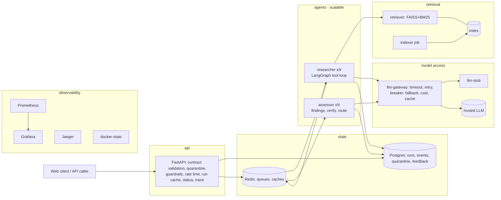

# Building Plan Compliance Pre-Check Service - Report

ML System Design & AgentOps (UE24AM342AA5), Mini Project 05 - Jackfruit (Level 3)

## 1. Problem and scope

An architect's office pre-checks drawings against the building bye-laws before submitting them
to the municipal authority; a single violated clause returns the plan and costs a resubmission
cycle. The difficulty is that requirements interact: a setback table selected by plot size can be
overridden by a height limit tied to road width that is printed somewhere else.

**Built:** a production-style multi-agent service that accepts a structured building proposal
plus free-text notes over a documented REST contract, validates it at the boundary, finds every
provision that binds it, produces per-provision findings with clause-level citations that resolve
to retrieved text, verifies them, and routes to `clear-for-submission`, `revise-and-recheck` or
`specialist-review` with a stated reason. It escalates instead of answering when provisions
conflict, an exemption may apply, the proposal is outside the corpus, the evidence cannot be
verified, or the model is unavailable. It never certifies a plan.

**Jurisdiction / corpus:** Bengaluru - *BBMP Building Bye-laws 2003* (84 pp.) and *BDA Revised
Master Plan 2015 Zoning Regulations* (69 pp.), both with text layers (no OCR needed), 881
clause-level chunks. Precedence is a declared project assumption (`corpus/manifest.yaml`): the
2007 zoning regulations govern setbacks / FAR / coverage / height / use where both documents speak.

**Out of scope (as briefed):** CAD/PDF plan parsing, model training, cloud deployment.

## 2. Architecture and deployment boundaries

16 compose services: 12 long-running, 2 one-shot jobs (secret generation, indexing) and 2
on-demand tools (eval, Locust), all started by one `docker compose up`. Why each
boundary sits where it does (scaling, failure isolation, independent release, resource profile):
`docs/architecture.md`. In short: the API must keep rejecting bad input when every agent is busy;
only the agents scale with model calls; the retriever carries the 1 GB ML image and its own
release cycle (re-index without redeploying agents); the gateway is the single place that knows
provider health, cost and which provider is configured.

## 3. Agent design

**Two agents, two containers, defined hand-off** (A2). The *research agent* finds and records
binding provisions; the *assessment agent* turns them into findings, verifies, and routes. They
communicate only through a persisted dossier and Redis queues (`q:research` -> `q:assess`, one
hand-back allowed). Failure mid-run: jobs are leased and heart-beaten; a dead worker's job is
re-queued by any worker's reaper; after 2 attempts, or past the 300 s run deadline, the run is
marked `failed` and routed to specialist review - never returned as an answer. Research is never
redone after the dossier is persisted.

**Tools the model chooses to call** (A1): `search_corpus`, `get_clause`, `follow_reference`,
`get_proposal_field`, `record_provision`, `finish_research`.

**What makes it an agent rather than a pipeline** (design approach steps 2 and 4):

* *Modifier check (step 2-3).* When the model first declares itself done, a separate step reads
  the provisions it recorded, asks which depend on a variable another provision might cap, and
  returns queries derived from that text plus cross-references found in it; the tool loop resumes
  with them. Measured on this index: the setback query and the brief's own sentence do **not**
  return the road-width height cap (`ZR2015:T10:ii.b`) in the top 6, while the derived query
  "maximum height of building restricted by road width" ranks it **first**
  (`docs/reference_case.md`).
* *Coverage check (step 5).* A mandatory topic still empty sends the model back with a different
  strategy (lexical mode, single document, references).
* *Verification (step 4, A3).* Deterministic: every citation must be a passage retrieved in this
  run; the quote must be verbatim; every number must come from the passage or the proposal (or
  follow from them via the stated derivation, evaluated safely); status must agree with
  `proposed <cmp> required`; every mandatory topic needs a verified finding. On failure: one
  retry with a different strategy (error list + strict re-quote), then one hand-back to research,
  then escalation with the unverified findings withheld. Demonstrated with the stub in
  "hallucinate" mode: a fabricated citation (`ZR2015:T99`, "buildings up to 30 m are permitted")
  fails verification, triggers the retry, and is never returned.
* *Deterministic routing.* The model never picks the route; `router.py` maps verified findings
  and flags to a route in a fixed order (degraded -> guardrail -> outside corpus -> conflict ->
  exemption -> violation -> insufficient evidence -> clear).

**Loop limits:** 14 model turns, 24 tool calls, 120 s wall clock for research (checked before
every call and passed down as the remaining timeout budget), 90 s for assessment, LangGraph
recursion limit as a backstop, three consecutive retriever failures end the loop.

## 4. Key design decisions and what was rejected

| Decision | Rejected alternative and why |
|---|---|
| Agentic retrieval with an explicit modifier step | Single-pass embed-and-answer: measured to miss the road-width cap for the section 4.1 case. |
| Structure-aware, clause-level chunks with a context header; hybrid dense + BM25 | Fixed windows split tables from their notes; dense-only misses exact table tokens ("9.0 m", "Table 10"). |
| Deterministic verification of quotes, numbers and status | LLM-as-judge as the primary check: extra cost per run, and the same model grading itself; kept out of the critical path. |
| Deterministic router; model only reports findings | Letting the model choose the route makes the "never certify / escalate when unsure" guarantee depend on prompt compliance. |
| Declared precedence ZR2015 > BBL2003 for governed topics | Escalating every cross-document disagreement: bye-law Table 5 and ZR Table 8 disagree for *every* building between 9.5 and 11.5 m, so nothing would ever route. Disagreements outside the declared topics still escalate. |
| Polling (202 + status URL) | Callbacks: callers sit behind NAT; webhooks add an SSRF surface and delivery retries for little benefit on 10-60 s runs. |
| Small Redis lease queue (~80 lines) | Celery/RQ: heavier, and we needed explicit lease/reap semantics plus trace-context propagation in the message. |
| One OpenAI-compatible gateway in front of every provider | Provider SDKs in the agents: provider change would mean code changes in two services; breaker state would be split. |
| FAISS via LangChain, incremental by content hash | Chroma: a server for 881 vectors; FAISS supports delete/add by id, which is all re-embedding needs. |
| Deterministic RAG-triad metrics ("TruLens-equivalent") | TruLens feedback functions: need an LLM judge per metric, cost and non-determinism. |
| Lexicon toxicity screen | A transformer toxicity model: ~400 MB extra in the API image; noted as a limitation. |
| Own docker-stats exporter | cAdvisor: cannot attribute containers on Docker Desktop's containerd store (INC-003). |

## 5. Evaluation

Set: 22 scenarios (`eval/scenarios.yaml`) with expected route, gold clauses, expected violations
and the supporting passage; includes the section 4.1 case. Metric definitions:
`docs/evaluation.md` (groundedness, context relevance, faithfulness, hallucination rate - computed
from the trace, on the assessor's first answer before verification filters it).

**Status:** the batch harness runs end to end (`eval/results/stub_harness_check.md`: 22/22
scenarios executed, all metrics computed, mean 20 s per run). With the **stub** the numbers are not
quality measurements - the stub never makes a determination, so only the five escalation
scenarios route correctly (5/22) - and are reported only as a harness check.

**Real model, reference case.** The section 4.1 case (S01) routes to `revise-and-recheck`, citing
RMP-2015 ZR Table 10 (ii)(b) - the road-width height cap the request never mentions - and, in the
run that also completed the modifier round, Table 9, on two different free-tier hosted models
(`eval/results/real_S01*.md`). Getting there exposed four defects the stub could not
(INC-005 to INC-008, summarised in section 8).

**Real model, full set.** A free tier allows a few hundred requests per model per day and a run
makes 15-30, so the three arms are run by the three team members in parallel, one slice of the
scenarios each, all arms of a slice on one machine (`docs/team_eval.md`, `scripts/team_eval.sh`).
Arms 2 and 3 replay the unchanged research steps from the model-response cache, which makes each
comparison controlled (same model, same research, only the variable under test differs) and fits a
slice in one day's quota. Runs the provider could not serve are flagged `provider_degraded` and
excluded from every metric. The slices are combined with `run_eval --merge`:

| arm | assessor prompt | modifier step | role |
|---|---|---|---|
| `real_v1` | v1 | on | L2 baseline |
| `real_v2` | v2 | on | L2 variant; L3 "before" |
| `real_nomod` | v2 | off | L3 "after" (the deliberate change) |

**L2 result** (`eval/results/compare_real_v1_vs_real_v2.md`): _to be filled in from the merged run._

**L3 result** (`eval/results/compare_real_v2_vs_real_nomod.md`): _to be filled in from the merged run._

## 6. Performance, scaling and cost

SLO declared before measuring (`docs/slo.md`): **p95 submit -> final result <= 45 s** at up to
1 run/s with the stub (800-2000 ms per model call). Full tables in `docs/loadtest.md`.

| Configuration | SLO holds up to | p95 at that load | Fails at | Peak throughput |
|---|---|---|---|---|
| 1 researcher x 4 slots (default) | 8 users | 35 s | 16 users (p95 75 s) | 0.20 runs/s |
| `--scale researcher=3 --scale assessor=3` | 16 users | 30 s | 32 users (p95 53 s) | 0.65 runs/s |
| 1 researcher x 16 slots | 32 users | 38 s | not reached | 0.81 runs/s |
| 1 researcher x 64 slots | 64 users | 25 s | not reached | 2.60 runs/s |

**Bottleneck.** Not CPU, not retrieval (search p95 18 ms), not the stub: the research worker's
run-slot limit. In every failing step the research queue backed up while in-flight runs sat
exactly at replicas x `WORKER_CONCURRENCY`, and agent containers used < 0.4 cores - the agents
are I/O-bound on the model. `--scale` helped only because it added slots; more slots per process
helped more. At 64 slots the next limit appears: the single researcher process reaches 1.0 core
(one event loop) and model-step latency rises 2.0 -> 3.2 s, which is where more processes
(`--scale`) become the right lever. With a real free-tier provider, the provider's per-minute
quota binds first, which is why the default stays at 4 slots.

**Caching (D7)** on a repeated-proposal workload: all caches off p95 21 s / 31.7k tokens per run;
LLM-response cache only p95 1.1 s / 1.4k billable tokens (96 % hits); whole-run cache p95 34 ms /
0 tokens. Rate limiting is per client (20 submissions/minute default), a cost control.

**Cost (L5).** Tokens and cost are recorded at call time per step and per run. Largest single
cost driver: the research agent's tool loop (`researcher.agent`, 75 % of tokens) because every
turn re-sends the system prompt, tool schemas and earlier tool results. Context compaction cut its
prompt tokens 30.1k -> 23.1k per run (-23 %; total -17 %). Projected cost per 100 runs at an
assumed $0.10 / $0.40 per 1M input/output tokens: **~$0.44 before, ~$0.36 after compaction**
(stub token estimates; the recorded cost on a free tier is $0).

## 7. Observability

Structured JSON logs with a correlation id (= run id) on every line across services; OpenTelemetry
traces exported to Jaeger, with trace context carried through the Redis queues so one trace covers
api -> researcher -> retriever/gateway -> assessor; Prometheus scrapes all 9 targets (worker
replicas discovered via Docker DNS); Grafana dashboard (32 panels): p50/p95 latency, error rate,
throughput, availability, per-container CPU/memory/uptime, per-agent success rate, steps and tool
calls per run, per-step latency, retry rate, circuit state, cost and tokens per agent/step, cache
hit ratios, index freshness, online quality, feedback. `GET /v1/runs/{id}/trace` reconstructs a
run: every tool call with arguments and returned chunk ids, every query, every passage, prompt
versions, per-step latency, tokens and cost, and each verification outcome.

## 8. What did not work (and what we changed)

* **cAdvisor on Docker Desktop** gave no per-container metrics (INC-003); replaced by a 90-line
  Docker-API exporter.
* **The circuit breaker never opened** in an outage because it counted requests, not attempts,
  and the agent degrades after one failed request (INC-002).
* **The LLM cache never hit** for resubmissions because a request id leaked into the prompt
  (INC-004); found only because the caching effect was measured, not assumed.
* **Docker Desktop would not start** on the dev machine (orphaned socket files, INC-001).
* **Compaction saved less than expected** (-17 %, not -50 %): the fixed per-call overhead
  (system prompt + 6 tool schemas) dominates; next steps would be provider-side prompt caching
  and shorter tool descriptions.
* **The stub cannot evaluate quality.** It made the system demonstrable without a key and made
  load tests meaningful, but L2/L3 numbers need a real model.
* **Chunking is heuristic.** Section detection relies on monotonic numbering; a few clauses are
  merged or windowed imperfectly (e.g. Table 23 parking spans two windows; a short "a) TDR..."
  note once merged into the next note until the minimum-segment threshold was lowered).
* **Free-tier quotas are per model and per day** (INC-005): one model allowed 20 requests a day,
  another 500; a run makes 15-30. The gateway now paces requests, waits out a 429 when the provider
  says how long, and otherwise fails fast to the degraded path. The evaluation was split across the
  team and made cache-replaying so that it fits.
* **Stub-shaped fixtures hid contract gaps** (INC-006, INC-008): the router assumed a field only the
  stub returned (every real violation crashed it); the verifier accepted a proposed value that occurs
  *somewhere* in the proposal (the side setback compared as the rear one); the assessor treated an
  exemption a provision offers as one the proposal invokes.
* **A lighter model never committed its research** (INC-007): it read clauses until the loop bound
  and recorded none. The agent now has an explicit commit step and keeps 40 % of its budget for the
  commit, modifier and coverage steps; the verifier also had to accept comparison-form derivations.
* **Still open:** on a wide road the model does not reliably report the road-width height cap as
  *not applicable*, so some clear cases escalate for "no verified finding for: height" - the safe
  failure direction, but a lost determination.
* **Load steps were 120 s**; at 16+ users in the baseline some runs outlived the step and are
  not counted, so those p95 values are lower bounds.

## 9. Requirements coverage

| Req | Where |
|---|---|
| F1, D1 | `common/contracts.py`, `contracts/*.schema.json`, `/v1/contracts`, `/docs` |
| F2 | `validate_proposal` + `cross_field_errors`, quarantine table, `/v1/quarantine` |
| F3 | `researcher.classify` (category + entities + signals) |
| F4 | research agent + modifier/coverage checks; `docs/reference_case.md` |
| F5 | assessor findings with `citations[]` (chunk id, clause label, page, verbatim quote, passage) |
| F6, F7 | `agents/router.py` |
| F8 | `/health` on every service, `/metrics`, structured logs |
| A1 | LangGraph graphs, 6 tools, loop bounds |
| A2 | `researcher` and `assessor` containers, queues, failure handling |
| A3 | `agents/verify.py`, retry / hand-back / withhold |
| A4 | 202 + polling, Redis queue |
| A5 | `gateway/main.py` (timeouts, backoff, breaker, fallback), agent fallback path, deadline reaper |
| A6 | `agent_*` metrics, Grafana "Agents" row, docker-stats uptime |
| A7 | `docs/loadtest.md` |
| A8 | `api/static/index.html` |
| L1 | `retriever/chunking.py`, `retriever/ingest.py` (`--reembed`) |
| L2 | `prompts/*.yaml`, prompt tag recorded on every model call and result; v1 vs v2 on the real model (section 5) |
| L3 | `eval/scenarios.yaml`, `bpc.evaluation.run_eval`, `docs/team_eval.md`; modifier step on vs off (section 5) |
| L4 | `common/guardrails.py`: injection screen + spotlighting, output filter, toxicity in/out |
| L5 | `run_events` tokens/cost per step, `/v1/admin/cost-report` |
| L6 | `/v1/runs/{id}/feedback`, `/v1/feedback/summary`, online scoring -> `quality_scores`, Grafana |
| D2 | `retriever/ingest.py` idempotent CLI; freshness + throughput metrics |
| D3 | `docker-compose.yml` (health checks, dependencies) |
| D4 | `.env.example`; generated secrets; no provider endpoint/key/LLM model id in the repo |
| D5 | `common/observability.py`, Jaeger, Prometheus, Grafana, `/v1/runs/{id}/trace` |
| D6 | `docs/slo.md` (declared first), `loadtest/`, `docs/loadtest.md` |
| D7 | four cache layers, per-client rate limit, measured in `docs/loadtest.md` |
| D8 | `docs/runbook.md`, `docs/incident_log.md` |

D4 note: the only model identifier in the repository is the default name of the open-source
**embedding** model (all-MiniLM-L6-v2, as named in the brief), kept so a clean clone starts with a
single `docker compose up`; it is overridable with `EMBEDDING_MODEL`. No LLM model id, provider
endpoint or credential is in the repository; database and Grafana passwords are generated at first
start.
